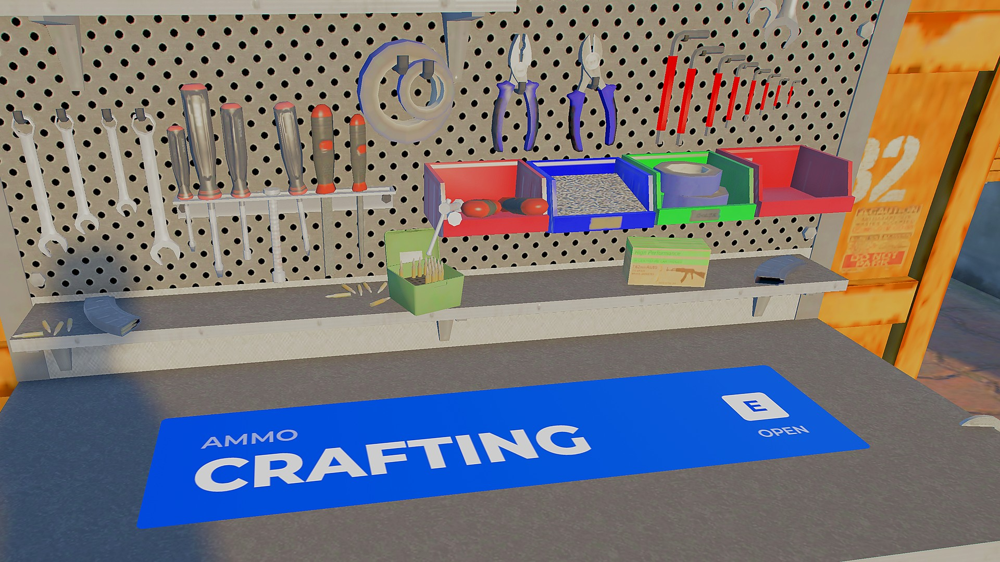
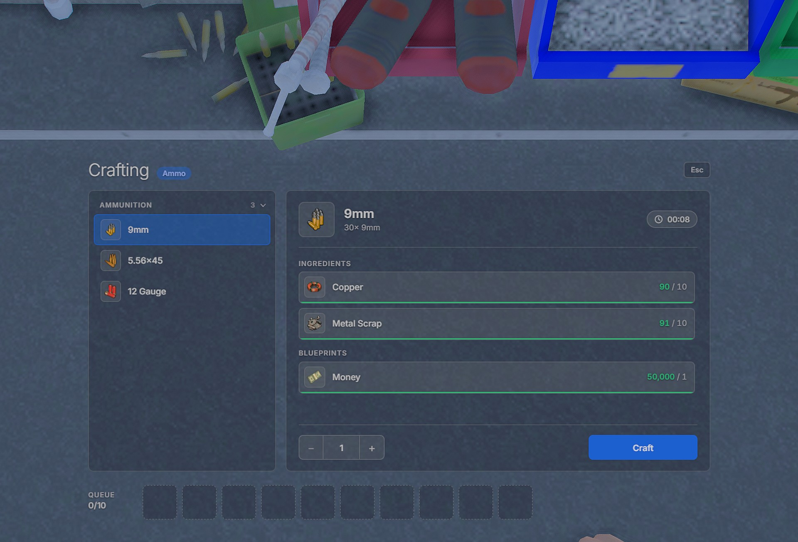
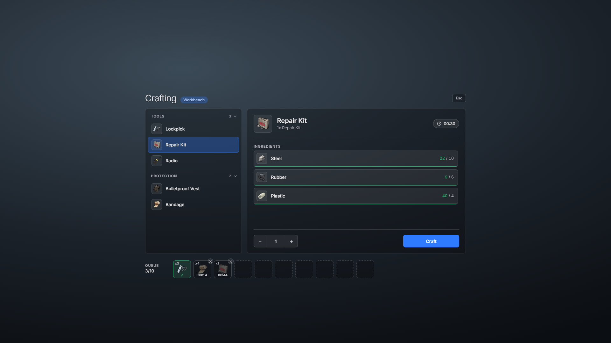
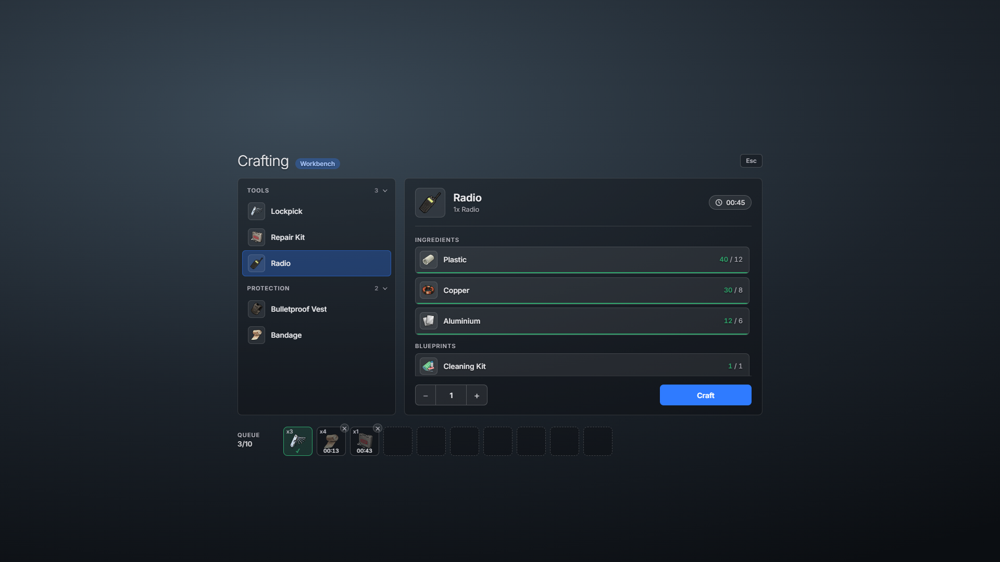
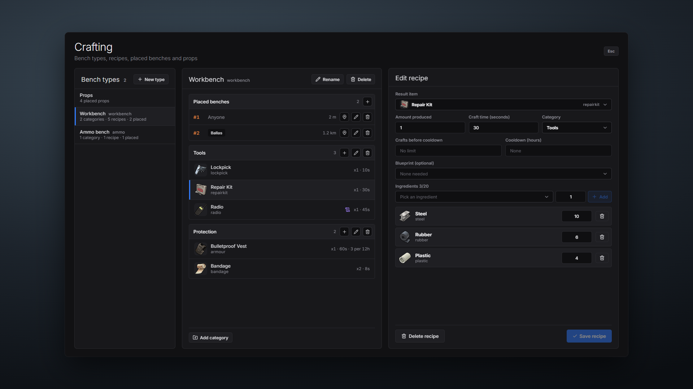
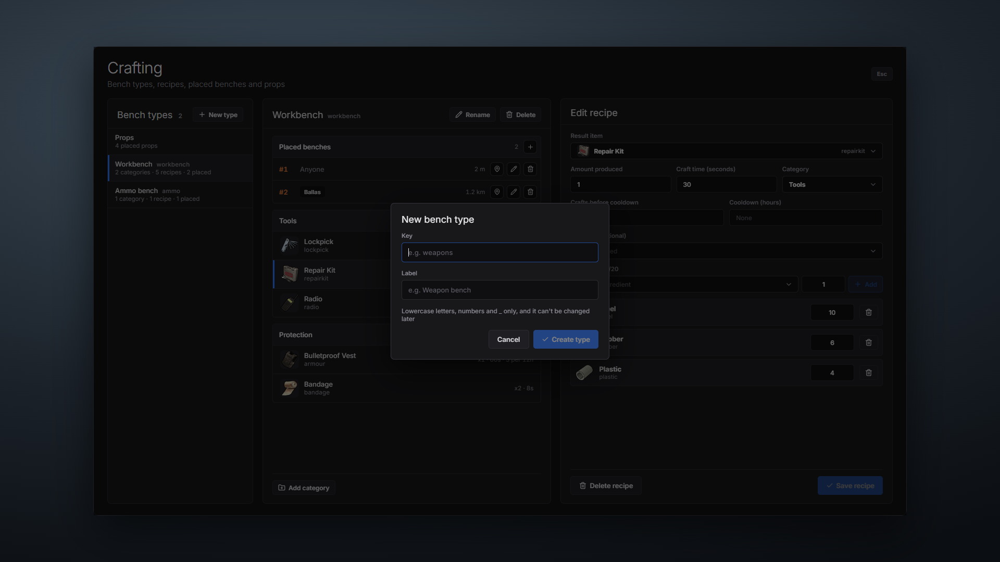
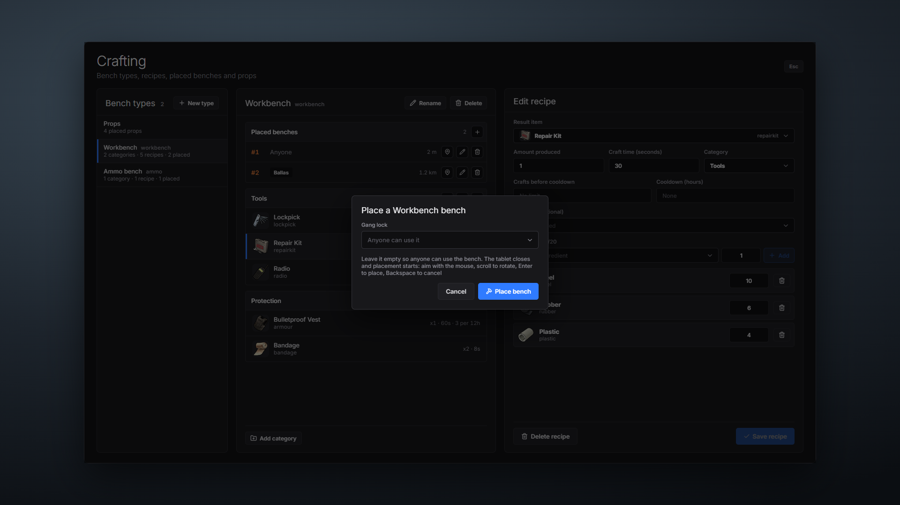
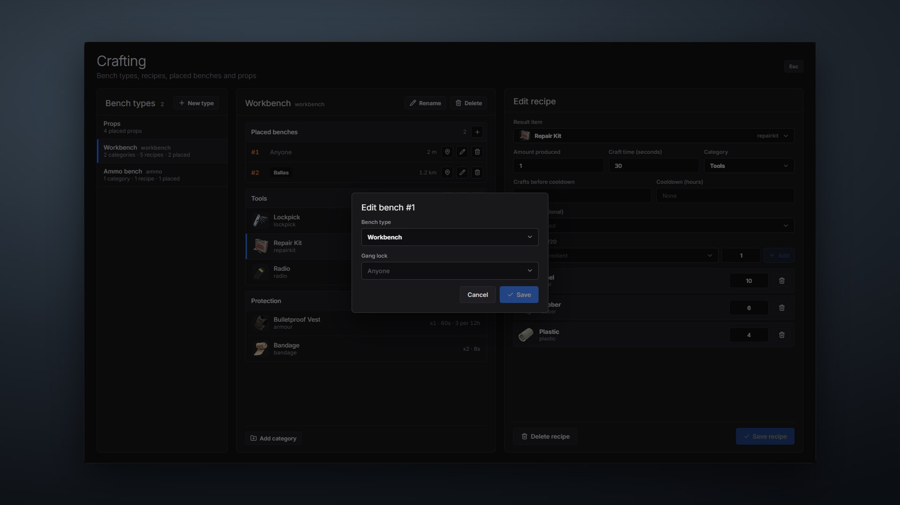
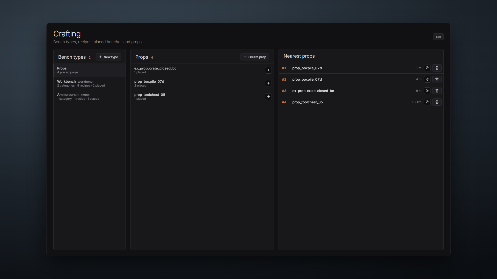

# whey_crafting

Placeable crafting benches for Qbox, with a tablet that lets staff build and change recipes in game. Nothing needs a restart: save a recipe in the tablet and every player sees it straight away.

## Screenshots

### The bench in the world

Every bench shows a banner on its top surface with the bench type and the key that opens it.



### Crafting at a bench

Press the key at a bench and the camera moves over the bench top. Recipes are on the left, grouped by category. The selected recipe is on the right, with each ingredient showing how many you have against how many you need. Your queue runs along the bottom. The menu is see-through, so the bench stays visible behind it.



With a few crafts queued, one of them ready to collect.



A recipe that needs a blueprint shows it next to the ingredients.



### The management tablet

Bench types on the left, the categories, recipes and placed benches of the selected type in the middle, and the recipe editor on the right.



Creating a bench type.



Placing a bench, with an optional gang lock.



Changing the type or gang lock of a bench that is already placed.



Decorative props, listed by model and by distance from you.



## Features

- **Crafting benches** placed anywhere in the world, each with a banner on the bench top and a camera view while you craft.
- **Bench types.** Every bench has a type (for example Workbench or Weapon bench) and each type has its own categories and recipes.
- **Live recipe editor.** Create, edit and delete bench types, categories and recipes from the tablet. Changes are saved to the database and sent to every player with no restart.
- **Craft queue.** Players queue several crafts, walk away and come back to collect. Queued crafts survive a server restart.
- **Cancel with refund.** Cancelling an unfinished craft gives the materials back.
- **Blueprints.** A recipe can need an item that is checked but not used up.
- **Craft cooldowns.** Limit a recipe to a number of crafts, followed by a wait in hours, per character.
- **Gang locked benches.** Lock any bench to one or more Qbox gangs.
- **Props.** Place decorative props from the tablet to dress up a crafting area.
- **Server side checks on everything.** Items, amounts, weight, distance to the bench, gang locks and permissions are all checked on the server.
- **Every text in one file.** All notifications, errors and interface text are in `locales/en.json`.

## Dependencies

| Resource | Needed |
|---|---|
| [qbx_core](https://github.com/Qbox-project/qbx_core) | Yes |
| [ox_lib](https://github.com/overextended/ox_lib) | Yes |
| [oxmysql](https://github.com/overextended/oxmysql) | Yes |
| [ox_inventory](https://github.com/overextended/ox_inventory) | Yes |
| [ox_target](https://github.com/overextended/ox_target) | Only if you turn on `interaction.target` |

OneSync must be on.

## Installation

1. Download the resource and put the `whey_crafting` folder in your `resources` folder. Keep the folder name.
2. Add it to `server.cfg` after its dependencies:
   ```
   ensure ox_lib
   ensure oxmysql
   ensure qbx_core
   ensure ox_inventory
   ensure whey_crafting
   ```
3. Start the server. The database tables are created automatically. There is no SQL file to import.
4. Add the tablet item to ox_inventory if you want one (see below).
5. Join, run `/crafttablet`, create a bench type and place your first bench.

The interface is already built. You do not need Node.js to run the resource.

## The tablet item

The tablet opens with `/crafttablet` by default. To also open it with an item, add this to `ox_inventory/data/items.lua` and restart ox_inventory:

```lua
['crafting_tablet'] = {
    label = 'Crafting Tablet',
    weight = 500,
    stack = false,
    close = true,
    description = 'Manage crafting benches and recipes.',
    client = {
        export = 'whey_crafting.openTablet',
    },
},
```

Holding the item is not enough to get in. The server still checks the permissions below every time.

## Adding items for recipes

Recipes use normal ox_inventory items. Any item, weapon, ammo or attachment that exists in `ox_inventory/data/items.lua` or `weapons.lua` can be a result, an ingredient or a blueprint. If the item you want is missing, add it to ox_inventory first, restart ox_inventory, then pick it in the tablet. Item pictures come from `ox_inventory/web/images`.

## Permissions

Set in `config/permissions.lua`. A player may open the tablet and manage benches when **any** of these is true.

| Setting | What it does |
|---|---|
| `ace` | The ACE permission that grants access. Default `whey_crafting.manage`. |
| `principals` | Groups given that ACE automatically on start. Default `{ 'group.admin' }`, which covers txAdmin admins. |
| `jobs` | Qbox jobs allowed in, as `job = lowest grade`. Example `{ police = 3 }`. |
| `gangs` | Qbox gangs allowed in, as `gang = lowest grade`. |
| `citizenids` | Single characters allowed in. |
| `custom` | Your own function, for example a Discord role check. Off by default. |

To give one person access without making them an admin, add this to `server.cfg`:

```
add_ace identifier.license:xxxxxxxxxxxxxxxx whey_crafting.manage allow
```

If you do not want every admin to have access, set `principals = {}` and grant the ACE yourself.

### Discord roles

There are two ways to tie access to a Discord role.

**1. Your Discord resource already gives out ACE groups.** Resources such as DiscordAcePerms put players into a group (for example `group.admin`) based on their Discord role. Nothing else is needed. Either keep that group in `principals`, or grant the ACE to the group in `server.cfg`:

```
add_ace group.staff whey_crafting.manage allow
```

**2. Your Discord resource only has a "does this player have this role" export.** wasabi_discord and Badger_Discord_API work this way. Use the `custom` option in `config/permissions.lua`. It is a function that gets the player's server id and returns `true` to let them in:

```lua
custom = function(source)
    return exports.wasabi_discord:checkRole(source, '123456789012345678')
end,
```

Replace the number with your Discord role id. The same option works with any wrapper of your own, as long as the function returns `true` or `false`. `config/permissions.lua` has a Badger_Discord_API example too.

The answer is remembered for `customCacheSeconds` (60 by default), so the Discord API is not asked on every click. A role removed in Discord can take up to that long to lose access.

## Configuration

All settings are in the `config` folder. Every option has a comment next to it.

| File | What is in it |
|---|---|
| `config/general.lua` | Debug prints, version check, the tablet command and keybind, queue size, the weight limit for one craft. |
| `config/permissions.lua` | Who can use the tablet. |
| `config/stations.lua` | Bench prop, render distances, placement controls, the interaction key or ox_target, the banner, the stand position, animation and camera. |
| `config/logs.lua` | A function called for every craft, collect, cancel and tablet change. Send it to your own log system. Empty by default. |

### Languages

English (`en`), Spanish (`es`), French (`fr`), German (`de`) and Brazilian Portuguese (`pt-br`) are included. Pick one in `server.cfg`:

```
setr ox:locale es
```

This is the ox_lib language setting, so it changes every ox resource on the server at the same time. To add another language, copy `locales/en.json` to a new file such as `locales/it.json` and translate the right hand side. Keep every `%s` and `%d` in the same order.

## Using it

**Staff**

1. Open the tablet with `/crafttablet`, the keybind, or the item.
2. Press **New type** and give it a key and a label.
3. Add a category, then add recipes to it. Pick the result item, the amount, the craft time and the ingredients.
4. Press the **+** next to **Placed benches** to place a bench of that type. Aim with the mouse, scroll to rotate, Enter to place.
5. Remove a bench with the bin icon next to it in the same list.

**Players**

Walk up to a bench and press **E** (or use ox_target). Pick a recipe, choose an amount and press **Craft**. The materials are taken and the craft joins your queue. Collect it from the queue when the timer ends.

## Database

The resource creates five tables on first start: `whey_crafting_tables`, `whey_crafting_types`, `whey_crafting_cooldowns`, `whey_crafting_queue` and `whey_crafting_props`. Every SQL statement the resource runs is in `server/db.lua` with a comment explaining it.

## Editing the interface

The interface is React and TypeScript, built with Vite. The source is in `web/src` and the built files are in `web/dist`.

```
cd web
npm install
npm run build
```

## Support

Open an issue on the [GitHub repository](https://github.com/wheylovesprotein/whey_crafting) with your server console output and the steps that lead to the problem. Set `debug = true` in `config/general.lua` first to get more detail.

## Credits

- Made by **wheylovesprotein**.
- Built on [ox_lib](https://github.com/overextended/ox_lib), [ox_inventory](https://github.com/overextended/ox_inventory) and [qbx_core](https://github.com/Qbox-project/qbx_core).
- Icons by [Lucide](https://lucide.dev). Fonts are Inter and Montserrat, both under the SIL Open Font License.

## License

Free to use and modify on any server. You may not sell it or put it behind a paywall. See [LICENSE](LICENSE).
